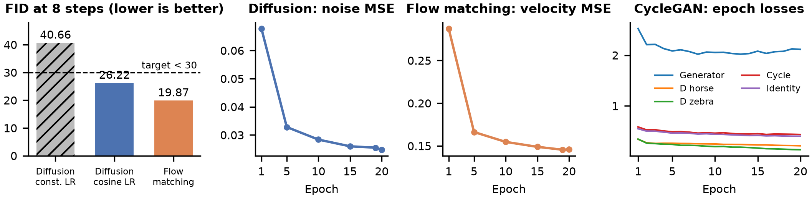
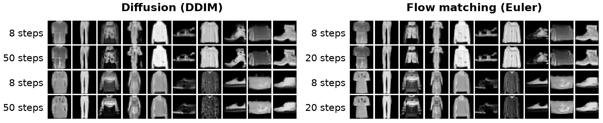
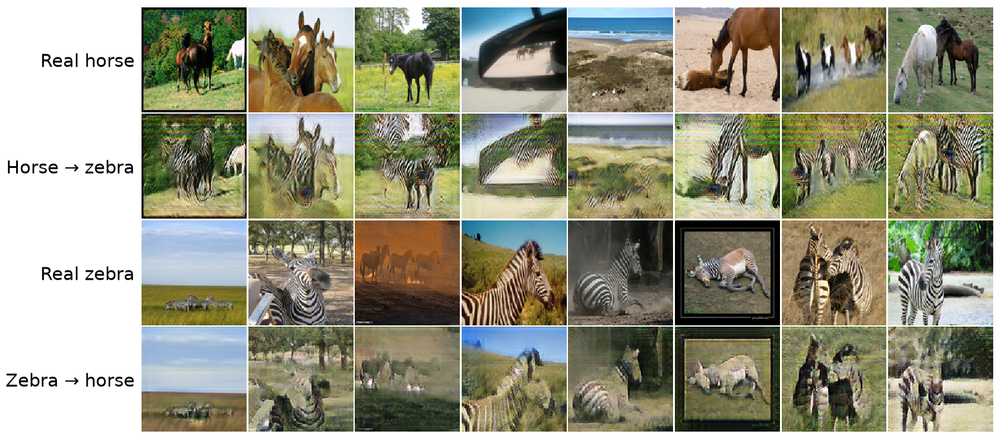
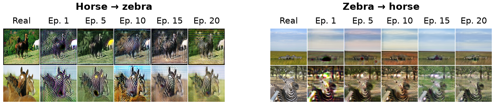

# CMPUT 328 Assignment 4

Generative Models: Diffusion, Flow Matching and CycleGAN

Laurie Gantuangco | Student ID: 1771419 | November 2026

## Results at a glance

**Table 1. One 20-epoch run per part**

| Part | Model | Evaluation | Result |
|---|---|---|---|
| 1. Diffusion | DiT (7.38M parameters), noise-prediction loss | FID, 8 DDIM steps | 26.22 (target < 30) |
| 2. Flow matching | Same DiT, velocity loss | FID, 8 Euler steps | 19.87 (target < 30) |
| 3. CycleGAN | 2 generators (7.83M each), 2 discriminators (2.76M each) | Visual, held-out test images | Horse→zebra works; zebra→horse weak |

**Figure 1. Both FashionMNIST models pass FID < 30; diffusion only after a learning-rate decay**

*Left: FID from the provided cell (9,984 test images against as many generated). The hatched bar is an earlier run of the provided constant-rate loop; its output was overwritten and is not in the notebook. Right: epoch losses printed by the notebooks.*

## Part 1 — Diffusion

- **Implemented:** sinusoidal timestep embedding with an MLP, a label embedding table, the adaLN-Zero DiT block, a linear β schedule with one-step noising, and a zero-variance DDIM sampler over evenly spaced timesteps.
- **Result:** FID 26.22 at 8 DDIM steps; noise MSE fell from 0.068 to 0.025.
- **One change to the provided loop:** with a constant learning rate the FID was 40.66, although that model scored about 23.5 at 50 steps. Adding a cosine learning-rate decay gave 26.22. The architecture and FID cell are untouched.

## Part 2 — Flow matching

- **Implemented:** training on straight noise-to-data paths (target velocity = data − noise, time uniform on [0, 1]) and a forward Euler sampler from t = 0 to t = 1.
- **Result:** FID 19.87 at 8 Euler steps with the provided loop unchanged; velocity MSE fell from 0.288 to 0.146.
- **Caveat:** not a controlled comparison with Part 1. These are single unseeded runs with different learning-rate schedules.

**Figure 2. The same starting noise sampled at 8 steps (the FID setting) and at the notebooks' default step count**

*Columns are classes 0–9. Generated for this report from the submitted checkpoints with the notebooks' own samplers.*

## Part 3 — CycleGAN

- **Implemented:** least-squares GAN loss (MSE on raw discriminator scores), L1 cycle and identity losses, both generator directions, and the real-image half of each discriminator loss.
- **Result:** horse→zebra paints stripes on most held-out horses, with tinted backgrounds and stripes bleeding outside the animal. Zebra→horse does not produce a horse coat.

**Figure 3. Horse→zebra adds stripes on held-out horses; zebra→horse does not produce horses**

*First 8 test images of each domain in filename order (not selected), final checkpoint. Produced for this report from the submitted checkpoint.*

**Figure 4. The same two test images per direction, translated by the checkpoints from epochs 1 to 20**

## Key takeaways

- **Flow matching scored best at 8 steps with no changes:** FID 19.87 (Figure 1).
- **Diffusion passed only after a learning-rate decay:** 26.22, against 40.66 for the constant-rate run (Figure 1).
- **The CycleGAN works in one direction:** stripes appear on horses, but zebras do not become horses (Figure 3).
- **All results are single unseeded runs,** so differences of a few FID points should not be over-read.

## AI-assistance disclosure

GitHub Copilot (agent mode in VS Code) helped implement the TODO sections and drafted this report and its figures. The notebooks were run locally instead of on Colab; the changes this needed are listed in each notebook.
